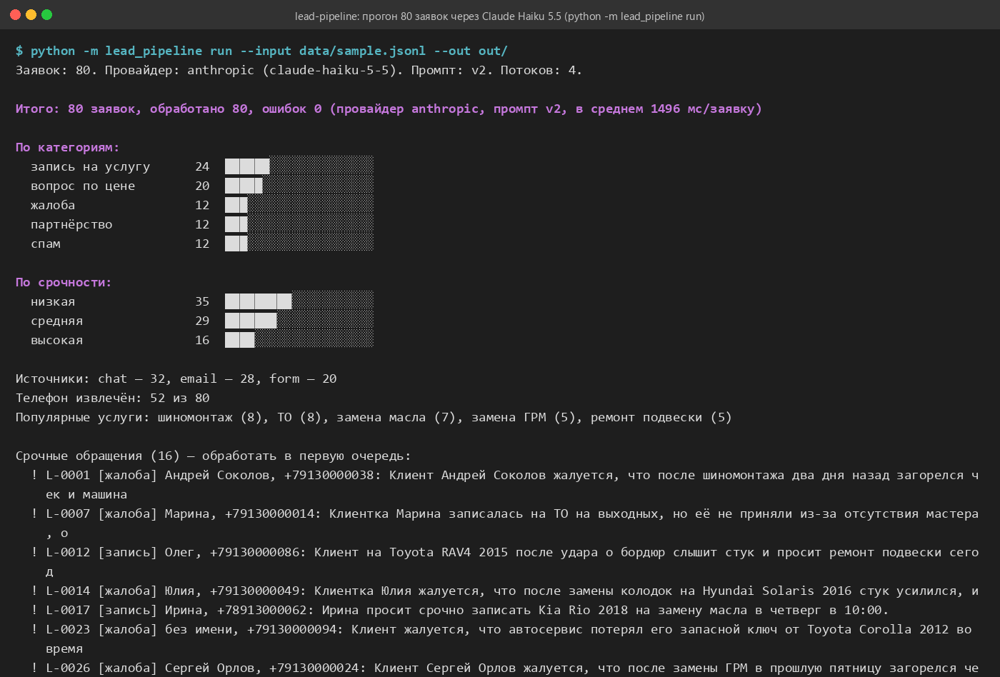

# lead-pipeline — LLM-конвейер обработки заявок

Входящие обращения (письма, заявки с сайта, сообщения из чата) → классификация и
извлечение полей через Claude → таблица CSV/XLSX → необязательная сводка в Telegram
и выгрузка в Google Sheets. Промпты версионируются, качество измеряется на размеченном
наборе.

> Pet-проект на синтетических данных: клиенты, телефоны и компании вымышлены
> (автосервис «Вектор», Омск). Собрано с помощью Claude Code на основе примеров из
> Anthropic Cookbook (см. раздел «На основе»).



## Задача

Заявки приходят в разные каналы и в свободной форме. Менеджер тратит время на то, чтобы
понять, что это — запись, вопрос о цене, жалоба, предложение партнёрства или спам, — и
переписать имя, телефон, услугу, дату и бюджет в таблицу. Нужен конвейер, который делает
это автоматически, предсказуемо и проверяемо.

## Решение

```
data/*.jsonl ──► lead_pipeline.pipeline ──► Claude (structured outputs, JSON по схеме)
                        │                        │ без ключа: эвристическая заглушка
                        ▼                        ▼
                 out/leads.csv  out/leads.xlsx  out/summary.json  → консольный отчёт
                        └──► (опционально) сводка в Telegram, лист в Google Sheets
```

1. **Схема результата** — Pydantic-модель `LeadAnalysis`: `category` (запись | цена |
   жалоба | партнёрство | спам), `urgency` (низкая | средняя | высокая), `summary`,
   `fields` (имя, телефон `+7XXXXXXXXXX`, услуга, желаемая дата, бюджет в рублях —
   или `null`). Модель отвечает **строго по этой JSON-схеме** через structured outputs
   (`client.messages.parse`), поэтому разбор ответа не зависит от «аккуратности» текста.
2. **Промпты** — `prompts/lead_analysis.v1.md`, `v2.md`: определения категорий, правила
   спорных случаев, нормализация полей. Версия промпта пишется в каждую строку результата.
3. **Провайдеры** — Claude (`claude-haiku-5-5` по умолчанию) или детерминированная
   заглушка на ключевых словах и регулярных выражениях — для тестов, CI и демонстрации
   без ключа API.
4. **Выгрузка** — CSV (UTF-8 с BOM, открывается в Excel), XLSX с автофильтром,
   закреплённой шапкой, подсветкой срочности и листом «Сводка».
5. **Оценка** — `evals/golden.jsonl`: 30 размеченных вручную обращений, тест считает
   точность категорий и срочности, печатает матрицу ошибок.
6. **Интеграции (выключены по умолчанию)** — сводка в Telegram через Bot API
   (`NOTIFY_TELEGRAM=1`), выгрузка на лист Google Sheets через gspread (`GSHEETS_ENABLED=1`).

## Стек

Python 3.11 · anthropic SDK (structured outputs) · Pydantic 2 · openpyxl · pytest ·
Docker · (опционально) gspread, Telegram Bot API

## Как запустить

```bash
git clone https://github.com/dobrewoks1/lead-pipeline.git
cd lead-pipeline
python -m venv .venv && .venv\Scripts\activate      # Linux/macOS: source .venv/bin/activate
pip install -r requirements.txt
copy .env.example .env                                # ANTHROPIC_API_KEY — если есть
```

**Прогон** на 80 синтетических заявках из `data/sample.jsonl`:

```bash
python -m lead_pipeline run --input data/sample.jsonl --out out/
```

Без ключа API конвейер предупредит и использует заглушку; с ключом — Claude.
Провайдер можно задать явно: `--provider fake | anthropic`, версию промпта — `--prompt v1`.
Результат: `out/leads.csv`, `out/leads.xlsx`, `out/summary.json` и отчёт в консоли
(категории, срочность, срочные обращения с телефонами, ошибки).

**Другие команды**:

```bash
python -m lead_pipeline generate --n 100 --seed 7 --out data/my.jsonl --labels data/my.labels.jsonl
python -m lead_pipeline eval --provider anthropic            # точность на золотом наборе
python -m lead_pipeline eval --provider anthropic --prompt v1  # сравнить версии промптов
python -m lead_pipeline prompts                               # список версий
```

**Тесты** (без сети и без ключей):

```bash
pytest
```

Тест `evals/test_golden_accuracy.py` проверяет порог: **точность категорий ≥ 90 %,
срочности ≥ 80 %**. По умолчанию он идёт на заглушке; `LEAD_EVAL_PROVIDER=anthropic pytest evals/`
запускает его на Claude (нужен ключ, иначе тест пропускается).

**Docker**:

```bash
docker build -t lead-pipeline .
docker run --env-file .env -v %cd%/out:/app/out lead-pipeline
```

## Результаты

| Набор | Провайдер | Промпт | Категории | Срочность | Поля (имя / телефон / услуга / дата / бюджет) |
|---|---|---|---|---|---|
| golden, 30 примеров | Claude Haiku 5.5 | v2 | **100 %** | 93 % | 100 / 100 / 93 / 83 / 97 % |
| golden, 30 примеров | Claude Haiku 5.5 | v1 | 97 % | 93 % | 97 / 93 / 87 / 80 / 93 % |
| sample, 80 синтетических | Claude Haiku 5.5 | v2 | 97,5 % | 94 % | 98 / 91 / 99 / 89 / 99 % |
| golden, 30 примеров | заглушка (правила) | — | 100 % | 93 % | 100 / 100 / 97 / 97 / 100 % |
| sample, 80 синтетических | заглушка (правила) | — | 96 % | 98 % | 100 / 88 / 96 / 99 / 100 % |

Прогоны на Claude сделаны 15.10.2026, `effort: low`, в среднем 1,5 с на заявку при 4 потоках.
Переход с v1 на v2 (правила спорных случаев и примеры) убрал ошибку на спорном примере и поднял
точность полей. Две ошибки на синтетике — «вопрос по цене» с намерением приехать, который модель
отнесла к записи: граница этих классов спорная по определению.

Цифры заглушки — нижняя планка: правила знают только ключевые слова, которые есть и в
синтетических данных. Реальная ценность конвейера — в модели, которая понимает перефразировки.

## Формат входа

JSON Lines, по одной заявке в строке:

```json
{"id": "L-0001", "source": "email", "received_at": "2026-10-05T17:01", "subject": "Запись на ТО", "text": "Добрый день! ..."}
```

Обязательны `id`, `source` (`email` | `form` | `chat`) и `text`; остальные поля
переносятся в результат как есть.

## Структура

```
lead_pipeline/
  schema.py      модели данных и JSON-схема      llm.py        Claude / заглушка
  prompts.py     загрузка версий промптов        pipeline.py   параллельная обработка
  export.py      CSV и XLSX                      report.py     сводка для консоли и Telegram
  notify.py      Telegram, Google Sheets         evalrun.py    точность и матрица ошибок
  generator.py   синтетические заявки            __main__.py   CLI
prompts/         lead_analysis.v1.md, v2.md, README.md
data/            sample.jsonl (80 заявок) + sample.labels.jsonl (разметка генератора)
evals/           golden.jsonl (30 примеров), test_golden_accuracy.py, README.md
tests/           pytest, 27 тестов, без сети
docs/            скриншот
```

## Ограничения и что можно улучшить

- Заглушка не заменяет модель: она нужна для тестов и демонстрации офлайн.
- Даты извлекаются словами из текста («в субботу утром»); следующий шаг — приводить их
  к календарной дате относительно `received_at`.
- Для больших объёмов (тысячи заявок) выгоднее Message Batches API — вдвое дешевле.

## На основе

| Что взято | Откуда | Лицензия |
|---|---|---|
| Извлечение структурированных данных по JSON-схеме (модель обязана заполнить схему), переведено на structured outputs | [Anthropic Cookbook — tool_use/extracting_structured_json.ipynb](https://github.com/anthropics/anthropic-cookbook/blob/main/tool_use/extracting_structured_json.ipynb) | MIT |
| Классификация обращений: определения категорий с примерами в промпте, оценка точности и матрица ошибок на размеченном наборе | [Anthropic Cookbook — capabilities/classification/guide.ipynb](https://github.com/anthropics/anthropic-cookbook/blob/main/capabilities/classification/guide.ipynb) | MIT |
| Формат structured outputs (`messages.parse` + Pydantic) | [документация Anthropic](https://platform.claude.com/docs/en/build-with-claude/structured-outputs) | — |

Собственный код проекта — MIT (см. `LICENSE`).

---

**English summary.** LLM pipeline for inbound leads of a fictional car service: synthetic
Russian emails, web-form and chat messages are classified (booking / pricing / complaint /
partnership / spam) with urgency, and contact fields (name, phone, service, date, budget) are
extracted by Claude via structured outputs against a Pydantic schema. Results go to CSV/XLSX
(openpyxl) with an optional Telegram summary and Google Sheets export (both off by default).
Prompts are versioned files; a 30-item hand-labeled golden set with an accuracy test
(threshold ≥ 90 % categories) guards quality. Works offline through a deterministic rule-based
provider used by the test suite. Built with Claude Code on top of MIT-licensed Anthropic
Cookbook examples; all data is synthetic.
